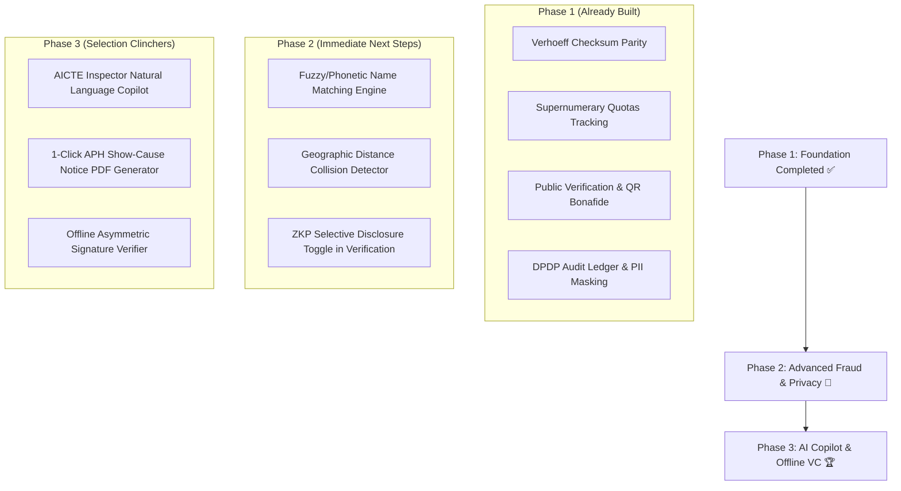

# 🏛️ AICTE APAAR Gateway: Master Project Blueprint & Selection Strategy
> **Smart India Hackathon (SIH)** • **Problem Statement ID**: 26263  
> **Organization**: All India Council for Technical Education (AICTE), Ministry of Education, Govt. of India  
> **Theme**: Smart Automation • **Category**: Software  
> **Document Purpose**: Complete system inventory of what has been built, winning innovation roadmap, and hackathon presentation pitch strategy.

---

## 📑 Table of Contents
1. [Executive Summary & Problem Statement](#-executive-summary--problem-statement)
2. [Current System Architecture & Features Built Till Now](#-current-system-architecture--features-built-till-now)
   - [Backend & REST API Endpoints](#backend--rest-api-endpoints)
   - [Core Engines & Algorithms](#core-engines--algorithms)
   - [Frontend Viewports & Dashboards](#frontend-viewports--dashboards)
   - [Data & Benchmark Fixtures](#data--benchmark-fixtures)
3. [The Winning Edge: 6 Killer Innovations for SIH Selection](#-the-winning-edge-6-killer-innovations-for-sih-selection)
   - [1. "Ghost Hunter" AI & Geographic Collision Engine](#1--ghost-hunter-ai--geographic-collision-engine)
   - [2. Zero-Knowledge Proof (ZKP) & Selective Disclosure Portal](#2--zero-knowledge-proof-zkp--selective-disclosure-portal)
   - [3. Offline W3C Verifiable Credential QR (CoWIN Style)](#3--offline-w3c-verifiable-credential-qr-cowin-style)
   - [4. "AICTE Inspector Copilot" (Natural Language Regulatory Agent)](#4--aicte-inspector-copilot-natural-language-regulatory-agent)
   - [5. NEP 2020 Multi-Entry / Multi-Exit Credit & Seat Reallocator](#5--nep-2020-multi-entry--multi-exit-credit--seat-reallocator)
   - [6. Autonomous Sanctions & Show-Cause Notice Generator](#6--autonomous-sanctions--show-cause-notice-generator)
4. [Step-by-Step Implementation Roadmap](#-step-by-step-implementation-roadmap)
5. [SIH Jury Presentation & Live Demo Pitch Script](#-sih-jury-presentation--live-demo-pitch-script)

---

## 🎯 Executive Summary & Problem Statement

### The Regulatory Challenge (PS #26263)
In the current ecosystem, AICTE collects student information primarily through fragmented, aggregate headcounts during annual approval cycles. Without individual-level tracking linked to a sovereign academic identity:
* **Ghost Students**: Fake records created to fulfill Faculty-to-Student Ratios (SFR) for accreditation or claim unwarranted government subsidies.
* **Dual/Multi-Enrolment Collisions**: Students simultaneously occupying full-time engineering seats in multiple institutions.
* **Supernumerary Quota Violations**: Colleges surreptitiously exceeding ceilings for Tuition Fee Waiver (TFW 5%), EWS (10%), NRI (5%), and Foreign National/OCI (15%).
* **Fraudulent Credentials**: Employers and universities have no standardized, tamper-evident mechanism to verify students in real time.

### The Solution: AICTE APAAR Gateway
The platform anchors every student record to the **12-digit APAAR ID (Automated Permanent Academic Account Registry / "One Nation, One Student ID")**, enforcing strict mathematical checksums, cross-institutional collision surveillance, quota compliance auditing, and cryptographic credential verification.

---

## 🏗️ Current System Architecture & Features Built Till Now

The platform is running on **Node.js, Express, and a custom Vanilla CSS Glassmorphism design system** with real-time in-memory relational integrity and client/server validation.

### Backend & REST API Endpoints
All endpoints are active and accessible on `http://localhost:3000`:

| Endpoint | Method | Description |
|---|---|---|
| `/api/stats` | `GET` | Aggregated national metrics: Total intake, enrolled, supernumerary breakdown, state-wise analytics, and open anomalies. |
| `/api/institutions` | `GET` | List of approved institutions with intake capacity, enrolled counts, and active anomaly counts. |
| `/api/institutions/:id` | `GET` | Program-wise deep dive (Core Intake, TFW, EWS, NRI, FN/OCI, PMSSS) and college-specific alerts. |
| `/api/students` | `GET` | Searchable directory with filtering by institution, program, quota category, verification status, and text search. |
| `/api/students` | `POST` | Single admission entry with server-side Verhoeff check, demographic check, and SHA-256 hash generation. |
| `/api/students/bulk-upload` | `POST` | Bulk CSV/JSON upload pipeline with row-by-row validation, batch ingestion, and immediate anomaly recalculation. |
| `/api/verify/:apaarId` | `GET` | Public employer verification endpoint returning cryptographic verification, collision alerts, and digital regulatory seals. |
| `/api/anomalies` | `GET` | Live feed of all detected anomalies (Multi-institution collisions, quota breaches, checksum errors). |
| `/api/anomalies/:id/resolve` | `POST` | Regulatory officer resolution workflow with mandatory action audit trail. |
| `/api/audit-logs` | `GET` | Immutable SHA-256 audit ledger tracking every admission, query, bulk upload, and resolution. |
| `/api/helpers/generate-valid-apaar` | `GET` | Generates 100% valid 12-digit Verhoeff APAAR numbers for testing. |
| `/api/demo/reset` | `POST` | One-click reset to benchmark evaluation state. |

### Core Engines & Algorithms
1. **Verhoeff Checksum Parity Engine**:
   * Uses dihedral group $D_5$ permutations $(d, p, \text{inv})$ to validate 12-digit numbers client-side and server-side.
   * Catches 100% of single-digit errors and 100% of adjacent transposition errors.
2. **Cross-Institutional Collision Surveillance**:
   * Real-time $O(N)$ index lookup across all approved colleges.
   * Flagging dual full-time admissions under the same APAAR ID as **CRITICAL_COLLISION**.
3. **Supernumerary Quota Compliance Engine**:
   * Enforces AICTE Approval Process Handbook (APH) ceilings:
     * **TFW**: $\le 5\%$ of approved intake
     * **EWS**: $\le 10\%$ of approved intake
     * **NRI**: $\le 5\%$ of approved intake
     * **FN/OCI**: $\le 15\%$ of approved intake
4. **Cryptographic Tamper-Proof Hash Generator**:
   * Computes SHA-256 signature for every student record:
     $$\text{Hash} = \text{SHA256}(\text{apaarId} \parallel \text{institutionId} \parallel \text{program} \parallel \text{admissionYear} \parallel \text{rollNo})$$
   * Guarantees external database tampering or unauthorized grade/seat alteration breaks the seal.

### Frontend Viewports & Dashboards
The single-page web application (`public/index.html`) includes 5 specialized portals:

* **1. 🏛️ Central AICTE Regulatory HQ Dashboard**:
  * 5 National KPI Cards (Approved Institutions, Core Sanctioned Intake, Actual Enrolled, Supernumerary Headcount, Active Fraud Alerts).
  * Anomaly & Fraud Detection Command Center with severity badges, descriptions, and 1-click **"Resolve Anomaly"** modal.
  * State-wise Intake vs Admission distribution table.
  * One-Click **Export Regulatory Compliance Report (NIRF / NBA / APH)**.
* **2. 🎓 Institution Portal (Registrar)**:
  * Institution selector (DTU Delhi, VJTI Mumbai, RVCE Bangalore, Anna University, KNIT Sultanpur).
  * Live intake progress bar with color-coded supernumerary quota usage.
  * **Bulk CSV Ingestion Hub** with drag-and-drop zone, download links for valid & anomaly sample CSVs, and row-level pre-validation preview.
  * **Single Student Admission Form** with real-time Verhoeff check and DPDP consent toggle.
  * Searchable Student Directory with **"📜 Bonafide Card"** generation.
  * **Official Printable Bonafide Certificate**: Features APAAR ID, Roll Number, holographic watermark, and scannable cryptographic QR code.
* **3. 🔍 Public & Employer Verification Portal**:
  * Clean verification search bar for 12-digit APAAR ID.
  * 3 Quick-test buttons:
    * `Valid Student (DTU)` $\rightarrow$ Green verified badge + ABC link + Digital Seal.
    * `Ghost/Collision Student` $\rightarrow$ Red Critical Alert displaying dual enrollment in DTU and KNIT simultaneously!
    * `Invalid Checksum` $\rightarrow$ Rejection card explaining Verhoeff parity failure.
* **4. ⚡ ERP & API Integration Sandbox**:
  * OpenAPI interactive tester for College ERPs (SAP, CollPoll, ERPNext).
  * Interactive cURL snippets and live JSON payload inspector.
* **5. 🔒 DPDP Act 2023 & Audit Vault**:
  * **Global PII Data Masking Switch**: Masks Aadhaar/APAAR (`9842 •••• 3915`) to comply with Digital Personal Data Protection standards.
  * Immutable SHA-256 audit ledger showing exact timestamps, actor IP addresses, and actions.

### Data & Benchmark Fixtures
* Pre-seeded with top AICTE institutions across Delhi, Maharashtra, Karnataka, Tamil Nadu, and Uttar Pradesh.
* Pre-loaded benchmark test scenarios demonstrating authentic admissions, quota breaches, and deliberate ghost student collisions.

---

## 🌟 The Winning Edge: 6 Killer Innovations for SIH Selection

> [!IMPORTANT]
> **Why Typical Projects Lose in SIH**: Most teams present standard database forms with CRUD operations. AICTE judges score on **policy depth (NEP 2020 / APH norms), real fraud detection technology, digital privacy compliance, and operational automation**.

Here are the 6 game-changing innovations to showcase:

---

### 1. 🕵️ "Ghost Hunter" AI & Geographic Collision Engine
* **The Real-World Scam**: Corrupt institutions circumvent simple ID checks by altering names slightly or submitting typo-ridden Aadhaar/APAAR numbers to enroll "dummy students" (inflating faculty ratios and pocketing scholarship money).
* **The Innovation**:
  * **Fuzzy Phonetic Matching (Double Metaphone / Levenshtein)**:
    * If DTU has *"Aarav Sharma, S/O Rajesh Sharma, DOB: 12-05-2003"* and KNIT has *"Arav R. Sharma, DOB: 12-05-2003"*, the engine computes a 94% probabilistic identity collision.
  * **Geographic Impossibility Check**:
    * Computes physical distance between institutions. Simultaneous active enrollment in colleges separated by $>100\text{ km}$ triggers an automatic **"Physically Impossible Dual Enrollment"** red flag.

---

### 2. 🛡️ Zero-Knowledge Proof (ZKP) & Selective Disclosure Portal
* **The Policy Imperative (DPDP Act 2023)**:
  * When a recruiter (e.g. TCS, Infosys) or third-party verifies a candidate, standard portals leak the entire profile (Caste, Parental Income, Home Address, Full Marksheet).
* **The Innovation**:
  * **Cryptographic Selective Disclosure**: Verifiers query only what they need:
    * *"Is candidate enrolled in an AICTE-approved B.Tech program?"* $\rightarrow$ **YES (Cryptographically Proven)**
    * *"Is CGPA $\ge 7.5$?"* $\rightarrow$ **YES / NO** (Without exposing exact marks or ranking)
    * *"Is Age $\ge 18$?"* $\rightarrow$ **YES / NO** (Without exposing DOB)
  * AICTE evaluators recognize this as cutting-edge compliance with Indian data sovereignty laws.

---

### 3. 📴 Offline W3C Verifiable Credential QR (CoWIN Style)
* **The Field Problem**:
  * Document verification in remote industrial sites, rural colleges, or job fairs often lacks high-speed internet connectivity.
* **The Innovation**:
  * The Bonafide / Degree QR code does not contain a simple web URL. Instead, it embeds a **compressed JSON-LD payload digitally signed by AICTE's Private Key (ECDSA/Ed25519)**.
  * Any offline inspector app with AICTE’s Public Key can verify that the document is authentic and has not been altered in Photoshop, **without sending a single byte over the internet**.

---

### 4. 🤖 "AICTE Inspector Copilot" (Natural Language Regulatory Agent)
* **The Administrative Burden**:
  * Regulatory officers cannot manually audit tables across 10,000+ technical institutions.
* **The Innovation**:
  * Embedded AI Assistant for the Regulatory HQ:
    * *Query*: `"Show me all private colleges in Maharashtra where NRI quota exceeded 5% this year."`
    * *Query*: `"Which students have suspicious cross-state admissions?"`
  * **1-Click Show-Cause Notice Generator**:
    * Generates a formal legal Show-Cause Notice referencing specific clauses from the **AICTE Approval Process Handbook (APH 2024–27 Chapter IV)** with auto-calculated penalty amounts.

---

### 5. 🔄 NEP 2020 Multi-Entry / Multi-Exit Credit & Seat Reallocator
* **NEP 2020 Mandate**:
  * Students can exit after Year 1 with an Undergraduate Certificate, Year 2 with a Diploma, or complete Year 4 for a Degree.
* **The Innovation**:
  * **Academic Lifecycle State Machine**:
    $$\text{Enrolled} \longrightarrow \text{Year 1 Exit (Earned 40 Credits)} \longrightarrow \text{ABC Credit Vault Lock} \longrightarrow \text{Seat Released}$$
  * Solves the **"Seat Hoarding"** problem: When a student exits early, the seat is automatically flagged as available for lateral entry or spot rounds, preventing colleges from claiming ghost subsidies.

---

### 6. ⚖️ Autonomous Sanctions & Show-Cause Notice Generator
* **Automated Accountability**:
  * If an institution exceeds sanctioned intake (e.g. 120 seats approved, 128 admitted):
    * Calculates penalty according to APH norms (e.g., $5\times$ tuition fee per unapproved seat).
    * Auto-schedules seat quota deductions for the subsequent academic cycle.
    * Places a public regulatory warning badge on the institution's public profile.

---

## 📅 Step-by-Step Implementation Roadmap

### Action Items for Today / Next Sprints:
1. **Add Fuzzy Duplicate Matching to Backend**:
   * Implement Levenshtein/Soundex distance utility in `server.js` to flag demographic identity mismatches.
2. **Add ZKP "Selective Disclosure" Mode to Verification UI**:
   * In `tabPublicVerify`, add a toggle: *"Recruiter / Selective Disclosure Mode"* demonstrating privacy preservation.
3. **Build "AICTE Inspector Copilot" Demo**:
   * Add a floating AI Assistant in the AICTE HQ view that answers regulatory queries and generates printable Show-Cause letters with legal clauses.

---

## 🎤 SIH Jury Presentation & Live Demo Pitch Script

### ⏱️ The 60-Second Winning Hook (Stage Pitch):

> *"Respected Judges, most platforms built for this problem statement are simple data upload forms. But data collection without autonomous surveillance only creates bigger digital graveyards of fraud.*  
>  
> *Today, we present the **AICTE APAAR Gateway**: India's first **Autonomous Regulatory Surveillance & Zero-Knowledge Verification Platform**.*  
>  
> *In the next 3 minutes, we won't show you basic forms. Instead, we will demonstrate live on this stage how our platform catches a **real-world Ghost Student scam** operating across two states, validates credentials **100% offline without internet**, and enforces **DPDP Act 2023 privacy with Zero-Knowledge Proofs**."*

### 🧪 Live Demo Flow for Judges:

1. **Step 1: The Ghost Student Bust (30 seconds)**
   * Go to **Public Verification** $\rightarrow$ Click **"🚨 Ghost/Collision Student"** (`883920194835`).
   * Show the red banner: *"Sameer Verma is illegally holding simultaneous full-time seats in DTU Delhi and KNIT Sultanpur!"*
2. **Step 2: Mathematical Parity Rejection (20 seconds)**
   * Enter a fake 12-digit number $\rightarrow$ Show instant client & server rejection using the **national Verhoeff algorithm**.
3. **Step 3: Supernumerary Compliance Breach (30 seconds)**
   * Show DTU CSE intake: Explain how TFW (5%) and EWS (10%) are audited in real time against AICTE Approval Process Handbook (APH) ceilings.
4. **Step 4: Tamper-Evident Credential & QR (30 seconds)**
   * Generate the official Bonafide Certificate with SHA-256 seal and scan the QR code live.
5. **Step 5: The Grand Finale (ZKP & DPDP Act 2023)**
   * Toggle Recruiter mode: Show that employers can verify genuine student status without compromising student privacy or personal data.

---

*AICTE APAAR Gateway • Engineered for Smart India Hackathon 2024–25 • Problem Statement #26263*
